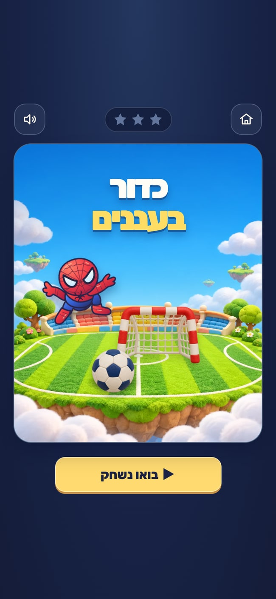
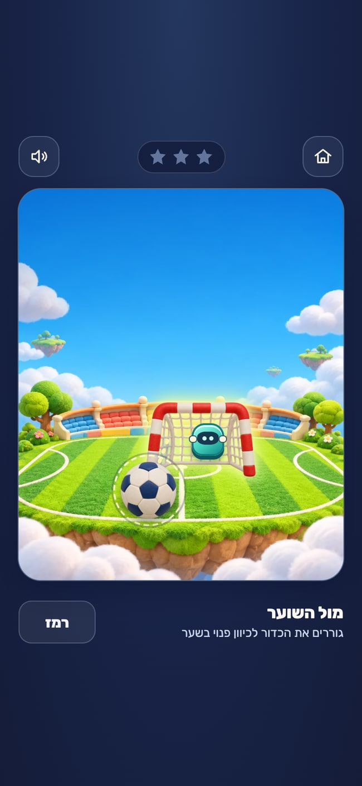
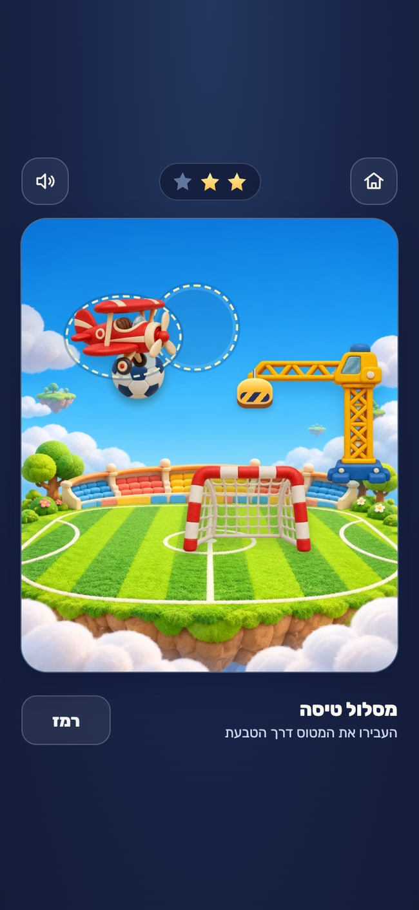

# כדור בעננים · Cloud Kick

משחק מגע לגילאי 5–6 עם שלושה אתגרי כיוון ותזמון במגרש שמרחף בעננים.

**[לפתוח ולשחק](https://amitshe.github.io/cloud-kick/)** · **[מגרש המשחקים](https://amitshe.github.io/)**

## איך משחקים

1. מקישים על **בואו נשחק**.
2. **מול השוער.** גוררים את הכדור לכיוון הרשת. הקו המקווקו מראה את הכיוון ונדלק בירוק כשהבעיטה מכוונת לצד הפנוי של השער.
3. **הקורים של ספיידרמן.** מקישים על **לירות קור** כשהכדור המעופף נכנס לטבעת והיא נדלקת. אפשר גם להקיש על הכדור באותו רגע.
4. **מסלול טיסה.** גוררים את המטוס דרך שתי טבעות שמופיעות בזו אחר זו, ואז אל וו המנוף. כשהקו שמתחת לוו ירוק, מקישים על הוו או על **לשחרר** כדי להפיל את הכדור לשער.
5. כל אתגר שהושלם מדליק כוכב. אחרי שלושה כוכבים מקישים על **עוד סיבוב** כדי לשחק עם מיקום שער ומסלול טיסה שונים.

אם מפספסים, אפשר לנסות שוב מיד באותו אתגר. כפתור **רמז** מצביע על הצד הפנוי בשער או על הטבעת הבאה במסלול הטיסה. כפתור הרמקול משתיק את הצלילים ושומר את הבחירה בדפדפן.

## צילומי מסך

<p align="center">
  
  
  
  
  
  
</p>

## הוספה למסך הבית

באייפון פותחים ב־Safari ובוחרים **שיתוף ← הוספה למסך הבית**. באנדרואיד פותחים ב־Chrome ובוחרים **הוספה למסך הבית** או **התקנה** בתפריט הדפדפן. לקיצור יש אייקון משלו.

## פיתוח מקומי

מתוך תיקיית הריפו מריצים:

```sh
python3 -m http.server 8000
```

פותחים את http://localhost:8000/ בדפדפן. המשחק סטטי ועובד ללא התקנת חבילות.

- `index.html` כולל את המגרש, האובייקטים ולחצני המגע.
- `style.css` מגדיר את הפריסה, ההדגשות והתצוגה בתנועה מופחתת.
- `game.js` מנהל את האתגרים, פעולות המגע, הניקוד וצלילי Web Audio.
- `manifest.json` מגדיר את ההפעלה מקיצור במסך הבית.
- `assets/` כולל את האיורים, האייקונים והגופנים. רישיון Rubik נמצא ב־`assets/rubik-license.txt`.

## פרסום

GitHub Pages מגיש את הקבצים משורש הענף `main` בנתיב `/cloud-kick/`. אין שלב בנייה. הקובץ `.nojekyll` מאפשר הגשה ישירה של הקבצים.
