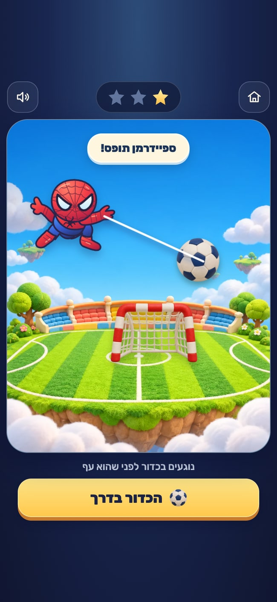

# כדור בעננים · Cloud Kick

משחק מגע לגיל הרך עם שלושה אתגרים במגרש שמרחף בעננים. מכוונים בעיטה, תופסים כדור עם ספיידרמן ומעבירים כדור ממטוס למנוף.

**[לפתוח ולשחק](https://amitshe.github.io/cloud-kick/)** · **[מגרש המשחקים](https://amitshe.github.io/)**

## איך משחקים

1. מקישים על **בואו נשחק**.
2. **בעיטה לשער.** גוררים את הכדור לכיוון הרשת ומשחררים. הקו המקווקו מראה לאן הבעיטה תגיע, והשער זוהר כשהכיוון מתאים.
3. **ספיידרמן תופס.** מקישים על הכדור כשהוא עף בשמיים. ספיידרמן יורה קור, מושך אותו ומעביר אותו לשער.
4. **מטוס ומנוף.** גוררים את המטוס אל העיגול הזוהר ליד וו המנוף. אחרי שהמנוף תופס את הכדור, נוגעים בוו כשהקו מתחתיו ירוק כדי לשחרר את הכדור לשער.
5. כל אתגר שהושלם מדליק כוכב. אחרי שלושה כוכבים מקישים על **עוד סיבוב** כדי לשחק כשהשער במיקום אחר.

אם הכדור מפספס, אפשר לנסות שוב מיד באותו אתגר. כפתור **רמז** מציג את הכיוון באתגרי הגרירה, ומאט את הכדור לזמן קצר באתגר הקורים. כפתור הרמקול משתיק את הצלילים ושומר את הבחירה בדפדפן.

## צילומי מסך

<p align="center">
  
  
  
  
</p>

## הוספה למסך הבית

באייפון פותחים ב־Safari ובוחרים **שיתוף ← הוספה למסך הבית**. באנדרואיד פותחים ב־Chrome ובוחרים **הוספה למסך הבית** או **התקנה** בתפריט הדפדפן. לקיצור יש אייקון משלו.

## פיתוח מקומי

מתוך תיקיית הריפו מריצים:

```sh
python3 -m http.server 8000
```

פותחים את http://localhost:8000/ בדפדפן. המשחק סטטי ועובד ללא התקנת חבילות.

- `index.html` כולל את המגרש, האובייקטים ולחצני המגע.
- `style.css` מגדיר את הפריסה, ההדגשות והתצוגה בתנועה מופחתת.
- `game.js` מנהל את האתגרים, פעולות המגע, הניקוד וצלילי Web Audio.
- `manifest.json` מגדיר את ההפעלה מקיצור במסך הבית.
- `assets/` כולל את האיורים, האייקונים והגופנים. רישיון Rubik נמצא ב־`assets/rubik-license.txt`.

## פרסום

GitHub Pages מגיש את הקבצים משורש הענף `main` בנתיב `/cloud-kick/`. אין שלב בנייה. הקובץ `.nojekyll` מאפשר הגשה ישירה של הקבצים.
